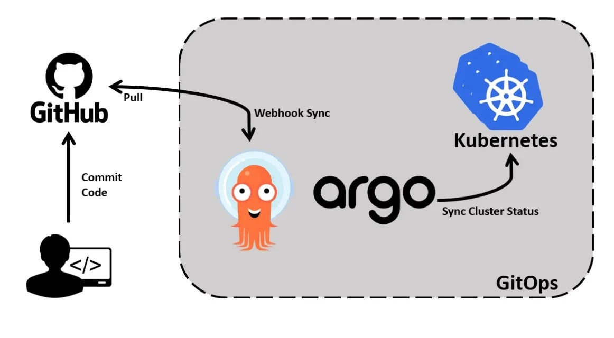
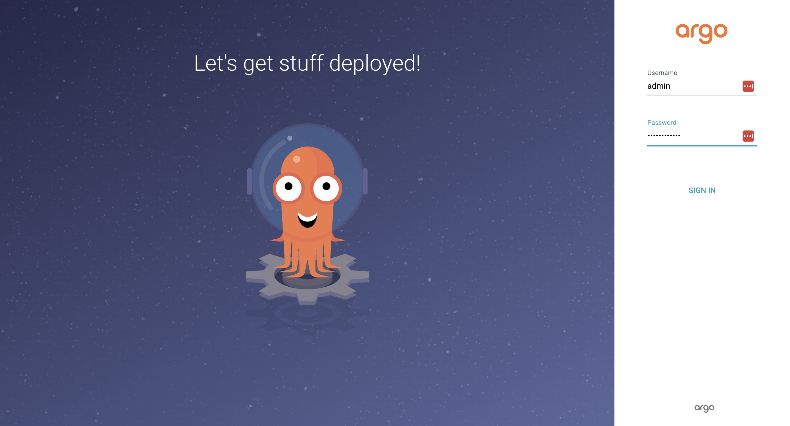
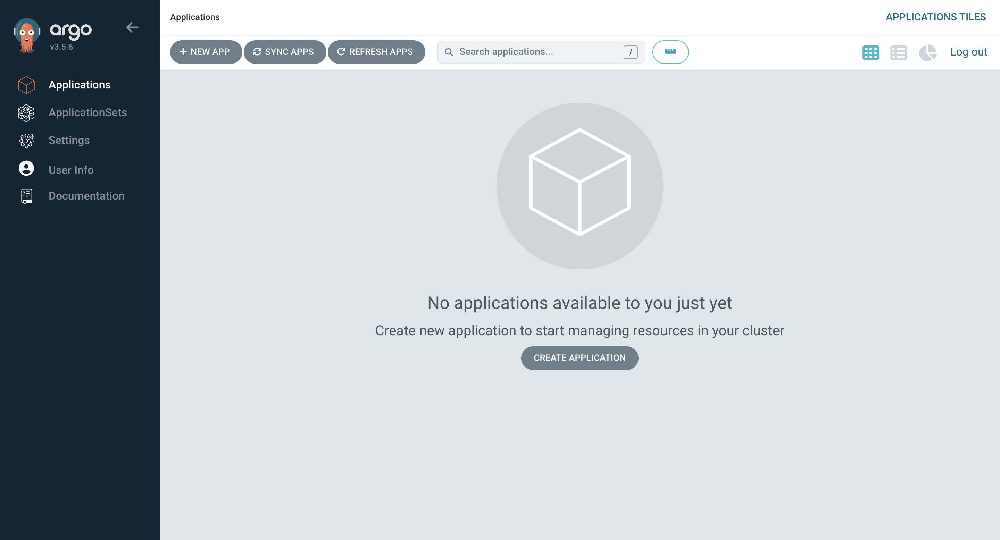
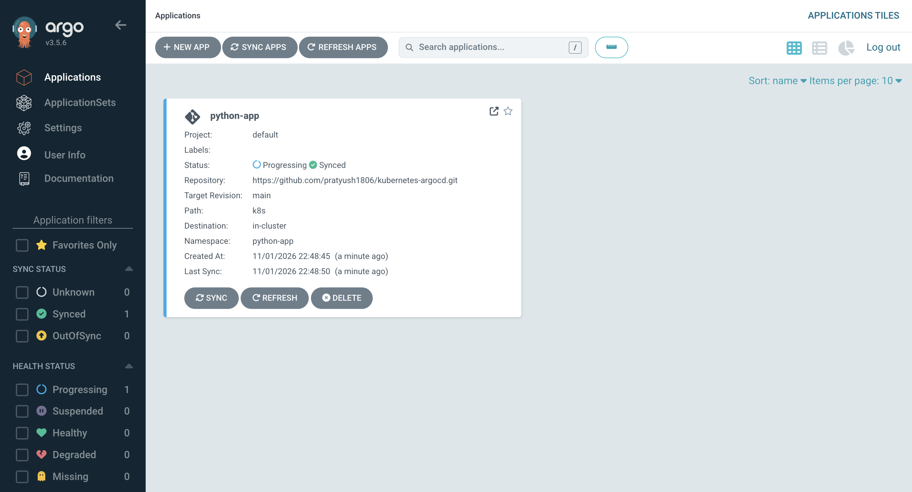
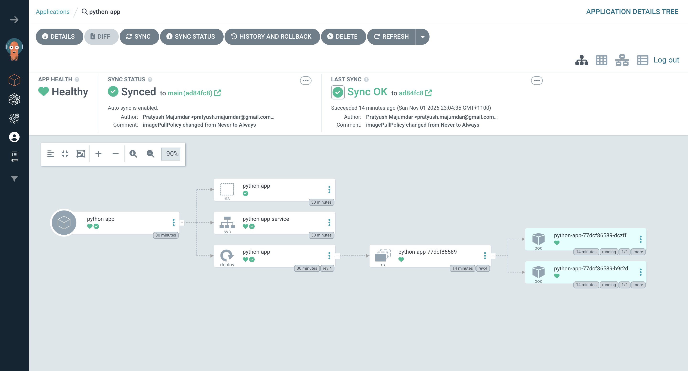
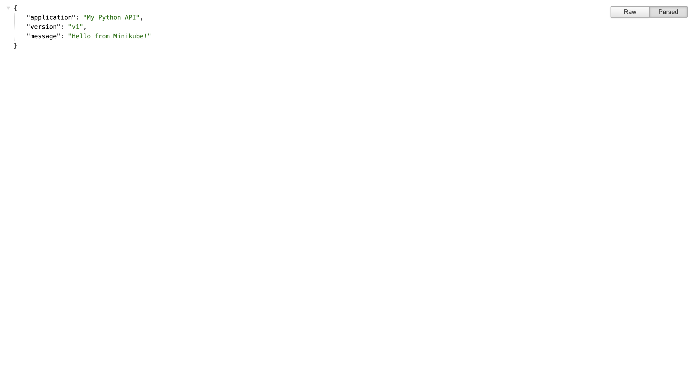

Argo CD is an open-source, declarative Continuous Delivery (CD) tool built specifically for Kubernetes. It follows the GitOps methodology, using Git repositories as the single source of truth for application configurations and deployment definitions.

Rather than relying on external pipelines to continuously push changes into Kubernetes clusters, Argo CD operates from within the Kubernetes environment, monitors the desired application state stored in Git, and ensures that the actual cluster state remains aligned with it.

This approach makes application deployments more predictable, auditable, consistent, and easier to manage.

### How Argo CD works
When an application is registered with Argo CD, we specify:

* The Git repository containing the Kubernetes configuration.
* The Git branch, tag, or commit to monitor.
* The directory containing the Kubernetes manifests.
* The destination Kubernetes cluster.
* The namespace where the application should be deployed.
* The synchronisation policy.

Argo CD continuously compares the desired state defined in Git with the actual state of the Kubernetes cluster. It identifies differences between the two states and reports whether the application is synchronised.



### 1. Install Argo CD
Argo CD runs inside the Kubernetes cluster and uses its own namespace to manage its components.

```
# create a namespace
kubectl create namespace argocd

# install argocd
kubectl apply -n argocd --server-side --force-conflicts -f https://raw.githubusercontent.com/argoproj/argo-cd/stable/manifests/install.yaml
```

The installation creates several Kubernetes components, including:

* Argo CD API Server
* Application Controller
* Repository Server
* ApplicationSet Controller
* Redis
* Dex Server
* Notifications Controller

### Check running Pods
Once the installation is complete, let's verify whether all the Argo CD components are running.

```
# check running pods
kubectl get pods -n argocd -o wide

NAME                                                READY   STATUS    RESTARTS      AGE   IP           NODE           NOMINATED NODE   READINESS GATES
argocd-application-controller-0                     1/1     Running   0             25h   10.244.2.5   minikube-m03   <none>           <none>
argocd-applicationset-controller-86bcdc46cf-cbzcl   1/1     Running   0             25h   10.244.2.3   minikube-m03   <none>           <none>
argocd-dex-server-7f65987db5-2tx5r                  1/1     Running   2 (25h ago)   25h   10.244.1.5   minikube-m02   <none>           <none>
argocd-notifications-controller-6885f68ddd-zlxv6    1/1     Running   0             25h   10.244.2.2   minikube-m03   <none>           <none>
argocd-redis-7d5d5cb5b6-8b8qv                       1/1     Running   0             25h   10.244.2.4   minikube-m03   <none>           <none>
argocd-repo-server-7f4759f94-tr8vq                  1/1     Running   0             25h   10.244.1.3   minikube-m02   <none>           <none>
argocd-server-777cfb8fc4-rwwm2                      1/1     Running   0             25h   10.244.1.4   minikube-m02   <none>           <none>
```

### Check running Services
The `argocd-server` service is particularly important because it exposes the Argo CD API Server.

By default, it is configured as a `ClusterIP` service, which means it is accessible from within the Kubernetes cluster.

```
# check running services
kubectl get service -n argocd -o wide

NAME                                      TYPE        CLUSTER-IP       EXTERNAL-IP   PORT(S)                      AGE   SELECTOR
argocd-applicationset-controller          ClusterIP   10.106.232.180   <none>        7000/TCP,8080/TCP            25h   app.kubernetes.io/name=argocd-applicationset-controller
argocd-dex-server                         ClusterIP   10.96.235.26     <none>        5556/TCP,5557/TCP,5558/TCP   25h   app.kubernetes.io/name=argocd-dex-server
argocd-metrics                            ClusterIP   10.100.49.150    <none>        8082/TCP                     25h   app.kubernetes.io/name=argocd-application-controller
argocd-notifications-controller-metrics   ClusterIP   10.110.102.37    <none>        9001/TCP                     25h   app.kubernetes.io/name=argocd-notifications-controller
argocd-redis                              ClusterIP   10.98.220.159    <none>        6379/TCP                     25h   app.kubernetes.io/name=argocd-redis
argocd-repo-server                        ClusterIP   10.99.203.169    <none>        8081/TCP,8084/TCP            25h   app.kubernetes.io/name=argocd-repo-server
argocd-server                             ClusterIP   10.105.146.106   <none>        80/TCP,443/TCP               25h   app.kubernetes.io/name=argocd-server
argocd-server-metrics                     ClusterIP   10.108.157.188   <none>        8083/TCP                     25h   app.kubernetes.io/name=argocd-server
```

### Accessing the Argo CD Dashboard
Since we are using Minikube, we can access the Argo CD dashboard using Kubernetes port forwarding.

```
# port forward command
kubectl port-forward -n argocd svc/argocd-server 8181:80

Forwarding from 127.0.0.1:8181 -> 8080
Forwarding from [::1]:8181 -> 8080
```
### Access ArgoCD UI
```
https://localhost:8181/
```



### Retrieving the Initial Admin Password
Argo CD creates an initial user `admin` and stores the password in a Kubernetes Secret named `argocd-initial-admin-secret`.

```
# extract the password and decode the base64 string.
kubectl -n argocd get secret argocd-initial-admin-secret -o json

{
    "apiVersion": "v1",
    "data": {
        "password": "SHIzUDE3Tkd0Vy1sb0Z6ZA=="
    },
    "kind": "Secret",
    "metadata": {
        "creationTimestamp": "2026-10-31T07:48:01Z",
        "name": "argocd-initial-admin-secret",
        "namespace": "argocd",
        "resourceVersion": "148687",
        "uid": "ced77344-5754-40d4-a0bd-fb3831f4e597"
    },
    "type": "Opaque"
}
```
### ArgoCD dashboard UI


### 2. Create an Argo CD Application (Argo CD Application Manifest).
Argo CD uses a Kubernetes Custom Resource Definition (CRD) called `Application` to define an application deployment. It's a declarative resource that tells Argo CD where to retrieve Kubernetes manifests and where to deploy them.
```
apiVersion: argoproj.io/v1alpha1
kind: Application

metadata:
  name: python-app
  namespace: argocd

spec:
  project: default

  source:
    repoURL: https://github.com/pratyush1806/kubernetes-argocd.git
    targetRevision: main
    path: k8s

  destination:
    server: https://kubernetes.default.svc
    namespace: python-app

  syncPolicy:
    automated:
      prune: true
      selfHeal: true

    syncOptions:
      - CreateNamespace=true
```

**Explaination**
1. `kind: Application`: This identifies the resource as an Argo CD Application.
2. `project: default`: Argo CD Projects provide logical grouping and access control for applications.
3. `source`: This section tells Argo CD where to retrieve the Kubernetes deployment configuration. There are three important properties -
  - `repoURL`: The Git repository containing the Kubernetes manifests.
  - `targetRevision`: The Git branch, tag, or commit Argo CD should monitor. In this case, it is the main branch.
  - `path`: The directory inside the repository containing the Kubernetes configuration files.
4. `destination`: This specifies where the application should be deployed.
  - `server`: server property identifies the destination Kubernetes API Server.
  - The address `https://kubernetes.default.svc `refers to the Kubernetes API Server accessible from within the cluster. This is commonly used when Argo CD deploys applications to the same cluster where it is installed.
5. `prune`: Pruning ensures that resources removed from the Git repository are also removed from the Kubernetes cluster during synchronisation.
6. `selfHeal`: Self-healing allows Argo CD to automatically correct configuration drift.
7. `CreateNamespace`: This option tells Argo CD to create the destination namespace automatically if it does not already exist.

### 3. Deploying the Argo CD Application
```
kubectl apply -f argocd-app.yaml

application.argoproj.io/python-app created
```

At this point, Argo CD will start processing the Application resource.

It will:
1. Connect to the configured Git repository.
2. Retrieve the main branch.
3. Locate the k8s directory.
4. Read and generate the Kubernetes manifests.
5. Compare the desired configuration with the cluster state.
6. Create the necessary Kubernetes resources.

Since we enabled automated synchronisation, Argo CD will automatically apply the deployment configuration.

### 4. Verifying the Application Deployment
```
kubectl get all -n python-app -o wide

NAME                              READY   STATUS    RESTARTS   AGE   IP           NODE           NOMINATED NODE   READINESS GATES
pod/python-app-77dcf86589-dczff   1/1     Running   0          15m   10.244.2.9   minikube-m03   <none>           <none>
pod/python-app-77dcf86589-h9r2d   1/1     Running   0          15m   10.244.1.9   minikube-m02   <none>           <none>

NAME                         TYPE       CLUSTER-IP     EXTERNAL-IP   PORT(S)          AGE   SELECTOR
service/python-app-service   NodePort   10.105.1.195   <none>        8000:30675/TCP   31m   app=python-app

NAME                         READY   UP-TO-DATE   AVAILABLE   AGE   CONTAINERS   IMAGES                   SELECTOR
deployment.apps/python-app   2/2     2            2           31m   python-app   prat1980/python-app:v1   app=python-app

NAME                                    DESIRED   CURRENT   READY   AGE   CONTAINERS   IMAGES                   SELECTOR
replicaset.apps/python-app-77dcf86589   2         2         2       15m   python-app   prat1980/python-app:v1   app=python-app,pod-template-hash=77dcf86589
```

The output indicates that:
1. Two application Pods have been created.
2. Both Pods are running.
3. The Deployment has two desired replicas.
4. Both replicas are available.
5. A NodePort Service has been created to expose the application.

### Verifying the Application in Argo CD
```
http://localhost:8181/applications
```



```
https://localhost:8181/applications/argocd/python-app
```



We are able to see:

1. The Application resource.
2. The Deployment.
3. The ReplicaSet.
4. The running Pods.
5. The Service.

### 5. Accessing the Python Application
The application is exposed through a Kubernetes NodePort Service. We can access it locally using port forwarding.
```
kubectl port-forward svc/python-app-service 8000:8000 -n python-app

Forwarding from 127.0.0.1:8000 -> 8000
Forwarding from [::1]:8000 -> 8000
```

### Accessing the Python Application through browser
```
http://localhost:8000
```


### 6. Understanding Automated Synchronisation Through GitOps
Te real value of GitOps becomes apparent when we start making changes to the application configuration.

**Scenario 1: Updating the Application Configuration**

We modify the Kubernetes Deployment manifest in the Git repository:

```
spec:
  replicas: 3
```

After committing and pushing the changes, Argo CD detects the updated configuration. Since automated synchronisation is enabled, Argo CD applies the new configuration to the Kubernetes cluster. Kubernetes then creates the additional Pod.

**Scenario 2: Manual Changes to Kubernetes Resources**

Imagine someone **manually** scales the Deployment to five replicas:

```
kubectl scale deployment python-app \
  --replicas=5 \
  -n python-app
```

The live Kubernetes configuration now differs from the desired configuration in Git. Because `selfHeal` is enabled, Argo CD detects the drift and restores the replica count to the value defined in the Git repository.

**Scenario 3: Removing Resources from Git**

Suppose we delete a Kubernetes Service manifest from the Git repository. Because `prune` is enabled, Argo CD removes the corresponding Service from the Kubernetes cluster during synchronisation. This prevents obsolete resources from accumulating in the cluster.

> Argo CD simplifies Kubernetes application delivery by introducing a declarative, GitOps-based deployment model.

Instead of relying on deployment pipelines to push configuration changes directly into Kubernetes, Argo CD continuously monitors Git repositories and reconciles the cluster with the desired application state.